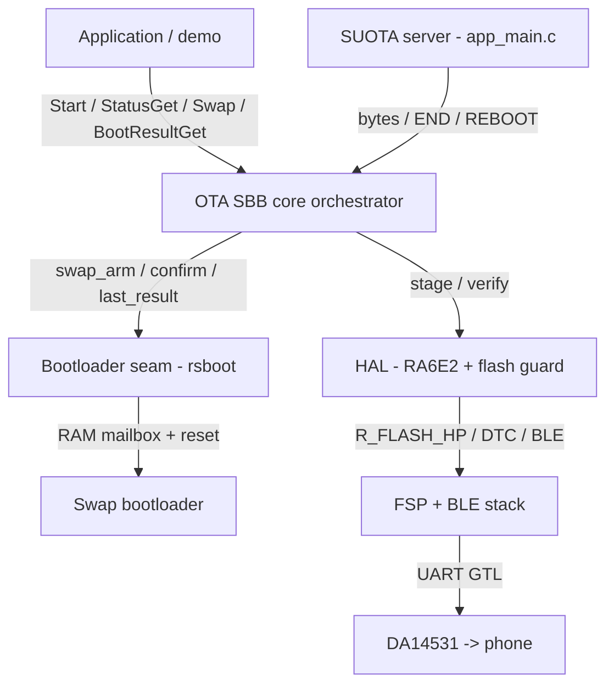

# OTA Firmware Update over BLE
## RA6E2 + DA14531

| | |
|---|---|
| **Host MCU** | RA6E2 (`R7FA6E2BB3CFM`, Cortex-M33) on the FPB-RA6E2 board |
| **BLE controller** | DA14531 (US159-DA14531EVZ on PMOD2) — GTL firmware over UART; the RA runs the BLE stack, the DA is a radio pipe |
| **Sender** | Stock Renesas SUOTA app — no custom phone app (see [SUOTA app settings](#63-suota-app-settings)) |
| **Bootloader** | Companion `ota_fw_bootloader` — MCUboot-style *swap using scratch*, embedded in this image at `0x00000000` |
| **Software** | Renesas FSP 6.5.0 + FreeRTOS + `r_ble_gtl` / `rm_ble_abs` |
| **Public API** | `Start` · `Stop` · `StatusGet` · `Swap` · `BootResultGet` · `BootloaderInfoGet` · `SecondarySlotGet` |

---

## Table of Contents

1. [Overview](#1-overview)
2. [Key Features](#2-key-features)
3. [Dependencies](#3-dependencies)
   - 3.1 [Hardware](#31-hardware)
   - 3.2 [Software Requirements](#32-software-requirements)
4. [FSP Configuration](#4-fsp-configuration)
   - 4.1 [BSP Settings](#41-bsp-settings)
5. [Demo Bring-Up](#5-demo-bring-up)
6. [Usage](#6-usage)
   - 6.1 [RTT Terminal](#61-rtt-terminal)
   - 6.2 [User Button S1](#62-user-button-s1)
   - 6.3 [SUOTA App Settings](#63-suota-app-settings)
7. [Data Flow Architecture](#7-data-flow-architecture)
   - 7.1 [Project Structure](#71-project-structure)
   - 7.2 [Software-Layer Architecture](#72-software-layer-architecture)
   - 7.3 [Module Configuration](#73-module-configuration)
   - 7.4 [Module Functions](#74-module-functions)
   - 7.5 [Bootloader Seam](#75-bootloader-seam)
   - 7.6 [The Bootloader](#76-the-bootloader)
   - 7.7 [Flash Layout](#77-flash-layout)
8. [Callback / Runtime Behavior](#8-callback--runtime-behavior)
   - 8.1 [Runtime Flow — Install on SUOTA REBOOT](#81-runtime-flow--install-on-suota-reboot)
   - 8.2 [Trial Boot and Health Gate](#82-trial-boot-and-health-gate)
   - 8.3 [Flash Guard](#83-flash-guard)
9. [Error Handling](#9-error-handling)
10. [Limitations](#10-limitations)
11. [Integration Recommended](#11-integration-recommended)
    - 11.1 [Integration Guide](#111-integration-guide)
    - 11.2 [Integration Checklist](#112-integration-checklist)
12. [Example](#12-example)
13. [Troubleshooting](#13-troubleshooting)
14. [References & Documentation](#14-references--documentation)

---

## 1. Overview

Reference OTA project in which an RA6E2 host receives a firmware
image over BLE, through a DA14531 BLE controller, using the standard SUOTA protocol and the
stock Renesas SUOTA phone app, stages it into internal code flash, and has a companion swap
bootloader install it — on trial, with automatic rollback if the new image does not confirm
itself. The whole workflow sits behind one public header, so the application never touches the FSP
flash driver, the BLE stack or the bootloader directly.

At boot the application asks the bootloader what it did on this boot, prints a banner, brings up the
DA14531 BLE link and advertises a SUOTA GATT service as `ra_suota`. The SUOTA app connects and
streams a firmware image in blocks; the OTA SBB erases the secondary slot, programs the image into it in
128-byte pages and verifies it. When the app asks for the new image to be activated (SUOTA *REBOOT*), the
application arms a trial install and resets. The bootloader swaps the secondary and primary slots,
the new image runs on trial, passes a health gate and confirms itself — or is rolled back on the next
reset.

```
 ┌───────────┐  BLE (radio)  ┌───────────┐  GTL over UART   ┌──────────────────────────────────┐
 │  Phone /  │ ────────────> │  DA14531  │ ───────────────> │  RA6E2                           │
 │ SUOTA app │  image bytes  │  (radio)  │  SCI0 @115200    │  application (primary slot)      │
 │ GATT      │               │ GATT srvr │  no flow control │    OTA: receive → stage → ask    │
 │ client    │               │ holds DB  │                  │          │            │ RAM      │
 └───────────┘               └───────────┘                  │          ▼            ▼ mailbox  │
                                                            │   secondary slot   bootloader    │
                                                            │   (staged image)   (0x00000000)  │
                                                            │          └── swap on reset ──┘   │
                                                            └──────────────────────────────────┘
```

The DA14531 is only a radio modem: it runs Renesas GTL firmware, holds the GATT database and forwards
BLE writes to the RA over UART. Its own firmware is never touched.

The division of labour is strict: the OTA SBB stages and asks, the bootloader validates and moves. The OTA SBB
never validates, moves or reverts an image and never writes boot state; the bootloader is the sole owner
of the flash map, the boot record, the sector exchange and resume-after-power-cut.

The reusable logic lives in `src/rs_ota_fw_update_over_ble/`. The demo application in `src/app/` is a
thin consumer: it reports the boot outcome, starts the OTA SBB, decides when to install (SUOTA request or
button S1), runs the trial health gate and writes diagnostics to SEGGER RTT.
---

## 2. Key Features

- **One public header** (`rs_ota_fw_update_over_ble.h`), seven functions, every one returning
  `rs_status_t`.
- **Non-blocking** — `Start()` brings the BLE transport up on its own task and returns; progress via
  `StatusGet()` polling or the callback. Install modes that only *arm* return too, so the application
  picks the moment to reset.
- **Standard SUOTA transport** — works with the unmodified Renesas SUOTA app; the full request/notify
  handshake (MEM_DEV / PATCH_LEN / PATCH_DATA / SERV_STATUS) is handled.
- **BLE survives flash erase** — every code-flash program/erase runs inside a *flash guard* that captures
  the DA14531 UART with the DTC and replays it, so not a byte of GTL traffic is lost (see
  [Architecture](#83-flash-guard)).
- **Install on request, not on completion** — a finished download only *stages* the image; it is
  installed when the phone sends SUOTA REBOOT, or when the user presses S1.
- **Trial boot + rollback** — the demo installs on trial; an image that fails to boot, to bring BLE up,
  or to pass its health gate is rolled back by the next reset.
- **Boot reporting** — `BootResultGet()` says whether this boot installed, reverted or rejected an image
  and whether the running image is still on trial; `BootloaderInfoGet()` identifies the bootloader in
  flash; `SecondarySlotGet()` describes the staged / rollback image.
- **One build, one image** — the application is linked once for the primary slot, one download programs
  bootloader + application, and the OTA payload is a flat copy of the primary-slot image.
- **No output device in the OTA SBB** — it never touches SEGGER RTT; every diagnostic line and status
  change goes to the single application callback.
- **Vendor/target isolation** — all FSP / BLE calls live in one HAL translation unit, the bootloader
  contract in one back-end file; the orchestrator and verifier contain no FSP/BLE references.
- **Fully static allocation** — no heap in the OTA path.
---

## 3. Dependencies

### 3.1 Hardware

| Resource | Purpose |
|---|---|
| FPB-RA6E2 board (`R7FA6E2BB3CFM`) | Host MCU |
| DA14531 module (US159-DA14531EVZ) on PMOD2 | BLE controller |
| UART link SCI0 @ 115200 (no flow control, no FIFO) | GTL transport RA ↔ DA14531 |
| User button S1 (P304) | Manual install trigger |
| SEGGER RTT (SWD) | Diagnostics / console (channel 0), output only |

```
                                          FPB-RA6E2 (top view, not to scale)
                         ┌──────────────────────────────────────────────────────────────────┐
                         │       ═══════ Arduino Uno R3 header ═══════          ┌────────┐  │
┌──────────────────┐     │   ┌────────┐                                         │    USB │  │
│ US159-DA14531EVZ │═════╪══►│ PMOD2  │                                         │ J-Link │  │
│ (BLE controller) │     │   └────────┘       ┌──────────────────────┐          │     OB │  │
└──────────────────┘     │   ┌────────┐       │                      │          └────────┘  │
                         │   │ PMOD1  │       │      RA6E2 MCU       │                      │
                         │   └────────┘       │                      │          LED2 LED1   │
                         │                    └──────────────────────┘         [S1] ──┐     │
                         │                                                     [S2]   │     │
                         │       ═══════ Arduino Uno R3 header ═══════          ▲     │     │
                         └──────────────────────────────────────────────────────┼─────┼─────┘
                                                                                │     │
         S2: Reset - reboots; the bootloader installs or rolls back the image ──┘     │
         S1: User button (P304) - installs the staged image ──────────────────────────┘
```

### 3.2 Software Requirements

| Tool | Notes |
|---|---|
| Renesas FSP 6.5.0 | BSP, drivers, FreeRTOS port, `r_ble_gtl` / `rm_ble_abs` |
| e² studio | Primary IDE; opens the project via the committed `.cproject` / `configuration.xml` |
| RA Smart Configurator (RASC) | Regenerates `ra/`, `ra_gen/`, `ra_cfg/` from `configuration.xml` |
| QE for BLE | Edits the SUOTA GATT profile; output merged via `scripts/qe_ble.bat` |
| Renesas Platform: Arm LLVM Toolchain - 21.1.1 | `clang` / `ld.lld` — e² studio Debug configuration and the VS Code kit (default) |
| Arm GNU Embedded toolchain 13.3 | `arm-none-eabi-gcc` (newlib) — e² studio Release configuration and the VS Code ARM GCC - Ninja kit (fallback) |
| VS Code *(optional)* | Second IDE, built with CMake (`CMakeLists.txt`) — independent of the e² studio build; needs the CMake Tools and Renesas debug extensions |
| CMake ≥ 3.20 + Ninja | VS Code build only |
| SEGGER J-Link + RTT Viewer | Flashing, debugging, and console output |
| Android phone + Renesas SUOTA app | The image sender — configure it as in [SUOTA app settings](#63-suota-app-settings) |

The project builds from e² studio (managed build: `.cproject`, `makefile.targets`) and from VS Code
(CMake: `CMakeLists.txt`, `cmake/`, `.vscode/`) out of the same sources. Neither build uses the other's
files. For VS Code, the Renesas Platform extension provides the toolchain kits, and the CMake files
find the Arm LLVM toolchain, Ninja and the Smart Configurator (RASC) automatically. Set
`ARM_TOOLCHAIN_PATH` or `RASC_EXE_PATH` only to override them.

---

## 4. FSP Configuration

> [!CAUTION]
> Never hand-edit `ra/`, `ra_gen/`, `ra_cfg/`. They are regenerated whenever `configuration.xml` is
> saved (and, in VS Code, on every CMake configure). Likewise, `qe_gen/ble/` is QE's working/merge
> area and is excluded from the build (`.cproject` and `CMakeLists.txt`); the sources actually compiled are the mirror under
> `src/rs_ota_fw_update_over_ble/ble/`.

### 4.1 BSP Settings

| Item | Value |
|---|---|
| Board / device / core | FPB-RA6E2 · `R7FA6E2BB3CFM` · Cortex-M33 |
| Code flash / RAM / data flash | 256 KB / 40 KB / 4 KB |
| RTOS | FreeRTOS (`rm_freertos_port`) |
| BLE transport | DA14531 GTL over SCI0 UART @ 115200 |
| Flash guard | Standalone DTC instance `g_transfer0`, activation source SCI0 RXI |
| BLE bonding storage | `rm_vee_flash` in data flash, starting at `+0x80` (the first 128 bytes belong to the bootloader) |
| FSP / toolchain | 6.5.0 / Renesas Platform: Arm LLVM Toolchain - 21.1.1 |
| Linker script | `script/ota.lld` (LLVM) / `script/ota.ld` (GCC kit in VS Code) — application at `0x00010000`, length `0x18000`; bootloader at `0x00000000` |

---

## 5. Demo Bring-Up

### Step 1: Open the Project

> **Note:** Use Step 1.A for e² studio and Step 1.B for VS Code

### Step 1.A: Open the Project in e² studio

Open the folder in e² studio (it uses the committed `.cproject` and `configuration.xml`). The
generated FSP content (`ra/`, `ra_gen/`, `ra_cfg/`) is produced by RASC as part of project setup.

### Step 1.B: Open the Project in VS Code

1. In VS code, File → Open Folder and select the `examples/fpb-ra6e2` folder
2. Select the Debug build variant (Command Palette → `CMake: Select Variant` → Debug).
3. When prompted for a kit, select `Renesas Platform: Arm LLVM Toolchain - 21.1.1` (the same toolchain as
   the e² studio Debug build). ARM GCC - Ninja is the fallback.
4. The default build type is Debug. On every CMake configure, RASC regenerates `ra/`, `ra_gen/`,
   `ra_cfg/` and `cmake/Generated*.cmake` from `configuration.xml` (`cmake/prebuild.cmake`). The
   FSP Smart Configurator task opens `configuration.xml` for editing.
5. After ra* autogenerate files are generated, press on Build

### Step 2: Editing the SUOTA BLE Profile (QE for BLE)

Because the compiled BLE server is a mirror of QE's output, use the helper to keep the two in sync
(QE only preserves code inside its `Start user code` / `End user code` blocks):

```bash
scripts/qe_ble.bat push   # copy the compiled BLE sources -> qe_gen/ble  (BEFORE "Generate Code")
# ... regenerate the profile in QE for BLE ...
scripts/qe_ble.bat pull   # copy qe_gen/ble -> compiled sources          (AFTER  "Generate Code")
scripts/qe_ble.bat diff   # list differences, change nothing
```

> [!WARNING]
> A QE regeneration drops two hand-edits that live in generated regions of `app_main.c`: the removal of
> the duplicate `R_BLE_VS_GetBdAddr()` call in `BLE_GAP_EVENT_STACK_ON` (otherwise advertising starts
> twice at boot), and the `(false == s_ota_erase_active)` term in the main loop (otherwise the BLE task
> blocks during the staging erase). Both are commented in place — re-apply them after every
> *Generate Code*.

### Step 3: Build

> **Note:** Use Step 3.A for e² studio and Step 3.B for VS Code

### Step 3.A: Build in e² studio

Build from e² studio. Besides the generated `.elf` / `.srec`, the build drops two extra artifacts in
`Debug/`:

| File | What it is |
|---|---|
| `ra6e2_da14531ebz_v2.elf` / `.srec` | The image to flash on the bench. Contains the bootloader at `0x00000000` *and* the application at `0x00010000`, so one download programs a complete, bootable board. |
| `ra6e2_da14531ebz_v2_ota.bin` | The OTA payload — the file to send with the SUOTA app. A raw copy of the primary-slot image, ready to be downloaded into the secondary slot. Contains no bootloader. ~57 KB. |
| `ra6e2_da14531ebz_v2_ota.map` | Linker map of the same build — every symbol and address of the payload, for post-mortem work on an image installed over the air. (No `_ota.elf` is produced: a second ELF confuses other IDEs; the main `.elf` is the debug image.) |

The payload is a flat, headerless binary — deliberately so. The bootloader reads the initial stack
pointer and reset vector from offset 0 of the slot, so prepending a SUOTA header would shift those words
and the swap would be rejected. No padding is needed either: the slot is erased to `0xFF` before staging.

These rules live in `makefile.targets` at the project root, which the generated `Debug/makefile` picks
up via `-include ../makefile.targets`. That include line comes from the RASC makefile *template*, so the rules survive "Generate Project Content". A post-build guard fails the build if the image
outgrows the `0x18000` slot — which also catches a `script/ota.lld` that lost its `FLASH_START` /
`FLASH_LENGTH` override. `make clean` removes both `_ota` artifacts.

#### The linker script

The application is linked with `script/ota.lld`, selected for the e² studio Debug configuration and
for the VS Code LLVM kit (the VS Code GCC kit uses the equivalent `script/ota.ld`). It includes the
generated `memory_regions.lld`, overrides `FLASH_START = 0x00010000` / `FLASH_LENGTH = 0x00018000`, trims
`RAM_LENGTH` by `0x20` for the boot mailbox, then includes `fsp_gen.lld`. The override lives in its own
file because "Generate Project Content" rewrites both `script/fsp.lld` and `memory_regions.lld`; an
override placed there is silently reverted and the build then produces an image that links cleanly and
cannot boot. Linker `ASSERT`s fail the build if the link address or length is wrong.

#### The embedded bootloader

There is no separate step to program the bootloader. The pre-built image is committed as
`src/rs_ota_fw_update_over_ble/bootloader.bin` and linked into every build:

| Piece | Role |
|---|---|
| `src/rs_ota_fw_update_over_ble/bootloader.bin` | The bootloader bytes (7708 B). Frozen ROM content — does not depend on the `ota_fw_bootloader` project being present or built. |
| `src/rs_ota_fw_update_over_ble/src/hal/rs_ota_fw_update_over_ble_boot_rsboot.c` | Opens with a `.incbin` block that turns the `.bin` into a `.bootloader` input section. Deliberately outside the back-end guard, so switching the back-end off cannot silently produce an image without a bootloader. |
| `script/ota.lld` / `script/ota.ld` | Places `.bootloader` at `0x00000000` (`KEEP`, or `--gc-sections` drops it — nothing references those bytes) and asserts it fits the 16 KB `BOOT_BOOTLOADER_SIZE` window. |
| `makefile.targets` / `CMakeLists.txt` | Strips `.bootloader` from the `_ota.bin` payload, and declares `bootloader.bin` as a dependency (`.incbin` records none). |

Consequences worth knowing:

- A mass erase followed by one download leaves a fully bootable board — but it also overwrites any
  bootloader already on the target.
- A debug session starts at the *application's* `Reset_Handler`; the bootloader is programmed but only
  runs after a real reset.
- The bundled bootloader is identified by fingerprint (CRC32 over its 7708 bytes = `0xE9645C84` →
  "v1.1.0 (bundled)"). To refresh it (rarely — it is meant to be frozen), rebuild `ota_fw_bootloader`,
  copy the result in, then update `RSBOOT_BL_BLOB_SIZE` / `_CRC32` / version in
  `..._boot_rsboot.c` — set the size first, flash once, and the banner prints the new CRC as
  "bootloader UNKNOWN (crc 0x........)":

  ```powershell
  Copy-Item ..\ota_fw_bootloader\Debug\bootloader.bin src\rs_ota_fw_update_over_ble\bootloader.bin -Force
  ```

### Step 3.B: Build in VS Code

Press Build on the status bar (or in the CMake view), or run the Build Project task. The output
goes to `build/Debug/`. It has the same `.elf`, `_ota.bin` and `_ota.elf` as the e² studio build, plus a
`.sbd` SmartBundle that the Renesas debugger needs.

`CMakeLists.txt` ports the e² studio rules:
- It replaces the `-T` script from RASC with `script/ota.lld` (LLVM kit) or `script/ota.ld` (GCC kit).
- It declares `bootloader.bin` as a dependency.
- It produces `_ota.bin` / `_ota.elf` with the same sections stripped.
- It runs the same `0x18000` slot-size guard (`cmake/ota_size_check.cmake`).

### Step 4: Flash & Run

> **Note:** Use Step 4.A for e² studio and Step 4.B for VS Code

### Step 4.A: Flash & Run in e² studio

Flash the `.elf` with J-Link using the bundled connection/launch files
(`OTA Update over BLE Debug_Flat.launch`).

### Step 4.B: Flash & Run in VS Code

Press Ctrl+Shift+D (Run and Debug) and start one of the `.vscode/launch.json` configurations:

| Configuration | Debugger | Needs |
|---|---|---|
| **Renesas GDB Debugging Default** | Renesas debugger (`renesas-hardware`), J-Link, device `R7FA6E2BB` | `RENESAS_GDB_PYTHONHOME`; the `.sbd` next to the `.elf` |
| **Renesas GDB Debugging Server** | `cortex-debug` against an external J-Link GDB server on `localhost:2331` | `ARM_GDB_PATH`; a running J-Link GDB server |

The launch configurations load the CMake target (`build/Debug/ota_update_over_ble.elf`) and run to `main()`.

### After flashing (both IDEs)

A single download of the `.elf` programs the
bootloader at `0x00000000` as well as the application at `0x00010000`. Reset the board after a
debug session to run through the bootloader. Execution then reaches the OTA workflow via:

```text
RESET
└─ bootloader @0x00000000        read mailbox → swap / resume / roll back → ack → jump 0x00010000
   └─ main()                      ← FSP generated
      └─ FreeRTOS BLE thread
         └─ ble_thread_entry()    ← FSP stub, delegates (src/ble_thread_entry.c)
            └─ app_ota_fw_update_over_ble_entry()   ← demo entry (src/app/)
               1. ota_log_init()                     // RTT, non-blocking
               2. ..._BootResultGet(&boot)           // what did the bootloader do on THIS boot?
               3. banner (versions, bootloader, reset cause, outcome, secondary slot)
               4. rs_ota_fw_update_over_ble_Start()  // PUBLIC API
               │    └─ ..._hal_transport_open()
               │         └─ xTaskCreateStatic("ota_ble", …) → app_main()   // BLE + SUOTA loop
               └─ 5. poll ..._StatusGet() every 250 ms, S1, trial health gate
```

The application calls only the public API. SUOTA events flow into the FW update over the air module through
`..._hal_feed_start/_block/_end/_install_request()`, and the transport glue asks `..._StatusGet()` for the
verdict it reports to the phone.

> [!NOTE]
> Because the transport owns a task, the event callback and the staging updates run on the BLE
> task, not the caller's. The orchestrator guards its state with `..._hal_lock()` /
> `..._hal_unlock()` (an RTOS critical section on target, no-ops on a host), so `StatusGet()` is safe
> from either thread. The dedicated task uses a static 2 KB stack.

The staging window is erased once per download, when the SUOTA client starts a transfer — not at
boot — so the secondary slot keeps the previous image (the rollback copy, or an image staged earlier)
until a new one actually arrives.

---

## 6. Usage

### 6.1 RTT Terminal

All diagnostics go over SEGGER RTT channel 0 — there is no UART console and no CLI. SCI0 is wired
to the DA14531 on PMOD2 and carries the GTL link, so a serial console would collide with the BLE
transport. RTT is output only.

| Sink | Used by | Defined in |
|---|---|---|
| `OTA_LOG()` / `OTA_LOG_HEX()` | Application only (`src/app`) | `src/app/ota_fw_update_over_ble_log.c` |
| `rs_ota_fw_update_over_ble_hal_log()` / `..._hal_logs()` | Everything inside the OTA SBB | `src/rs_ota_fw_update_over_ble/src/hal/rs_ota_fw_update_over_ble_hal_ra6e2.c` |

Only `src/app` may call `SEGGER_RTT_*`. The OTA SBB formats each line and hands the finished string to
the single application callback (`cfg->p_callback`), which this demo forwards to `OTA_LOG()`. Its lines
produced before the callback is registered are parked (8 lines) and replayed on registration.
`ota_log_init()` arms up-buffer 0 as `SEGGER_RTT_MODE_NO_BLOCK_SKIP` — keep it that way, or a full FIFO
with no viewer attached stalls the BLE thread. Define `OTA_LOG_DISABLE` to compile the trace out.

Every boot prints a banner. Each image carries a 64-byte version record (`APP_VERSION_*` in
`src/app/ota_fw_update_over_ble_log.h`), and the banner scans the secondary slot for it, so it can tell
a pending update from a rollback copy:

```text
[APP]  OTA firmware update over BLE (RA6E2 + DA14531)
[APP]  app          ra6e2_da14531evz v1.0.0  (build ...)
[APP]  bootloader   v1.1.0 (bundled, crc 0xE9645C84)
[APP]  boot record  layout v3, N update(s)
[APP]  reset        SOFTWARE, warm start
[APP]  boot         outcome=SWAPPED
[APP]  secondary    ... @0x00028000 - older - rollback copy
[APP] press S1 to install the image in the secondary slot
```

A transfer then logs concise progress lines:

```text
[SUOTA] Transfer start (mem_dev=0x13000000) - erasing staging
[FWACQ] erase block 0 @0x00028000 -> err=0
[FWACQ] erase block 1 @0x00030000 -> err=0
[FWACQ] erase block 2 @0x00038000 -> err=0
[SUOTA] staging erased - image transfer may start
[SUOTA] -> notify SERV_STATUS = 0x10 (IMAGE_STARTED)
[SUOTA] Block length set to 1024 bytes
...
---- END OF IMAGE ---- (cmd 0xFE000000)  File length received = 58752 bytes
[APP] image staged + verified (58752 bytes) - awaiting SUOTA reboot request or S1
---- REBOOT ---- (cmd 0xFD000000)  File length received = 58752 bytes
```

> [!WARNING]
> The payload must fit the flat 96 KB (98 304-byte) secondary slot. An oversize image fails near the
> end of the transfer with *"Not enough internal memory space for patch"* (`0x07`).

### 6.2 User Button S1

```
        FPB-RA6E2 (top view)
┌──────────────────────────────────┐
│ ┌───────┐                ┌─────┐ │
│ │ PMOD2 │   ┌───────┐    │ USB │ │
│ └───────┘   │ RA6E2 │    └─────┘ │
│ ┌───────┐   └───────┘            │
│ │ PMOD1 │                 [S1] ◄─┼── S1: User button (P304)
│ └───────┘                 [S2]   │
└──────────────────────────────────┘
```

Pressing S1 (the FPB-RA6E2 user button, P304) installs whatever is already staged, so the
swap/trial/revert sequence can be replayed from a board that has been sitting idle — no phone, no
transfer:

```text
[APP] press S1 to install the image in the secondary slot
...
[APP]  INSTALL      requested by S1 - TRIAL image armed
```

If a transfer is in progress or the secondary slot is empty, the install is refused and the application
carries on (`[APP] S1: install refused - secondary slot is empty`).

| Aspect | Choice | Why |
|---|---|---|
| Detection | `R_BSP_PinRead(SW1)` polled in the existing 250 ms loop | P304 is already an input in the generated pin data; an ICU/external-IRQ instance would need a configuration change and a regeneration. |
| Debounce | None beyond the 250 ms sample period | Far longer than any contact bounce. |
| Edge | Press edge only, seeded from the pin's state at start-up | Holding S1 cannot re-arm repeatedly, and a board powered up with S1 held does not self-trigger. |
| Swap mode | `APP_BUTTON_SWAP_MODE`, default `..._AFTER_RESET_WITH_TEST` | A manual install of a broken image is still undone by the next reset. Change it to `..._AFTER_RESET` for a permanent install with no safety net. |
| During a trial | Ignored | The secondary slot then holds the rollback copy; installing it would fight the bootloader's rollback. |

Both paths go through the same `app_install_staged_image()` helper, so they arm, drop the BLE link and
reset identically — only the decision to go differs.

### 6.3 SUOTA App Settings

Use the stock Renesas SUOTA app. After selecting the device (`ra_suota`) and the image file, set the
update parameters exactly as follows before starting the transfer:

| Setting | Value |
|---|---|
| **Memory type** | SPI |
| **Image bank** | Oldest |
| **Block size** | 1024 (maximum) |
| **MISO GPIO** | P0_5 |
| **MOSI GPIO** | P0_6 |
| **CS GPIO** | P0_3 |
| **SCK GPIO** | P0_0 |

**The file to send is `Debug/ra6e2_da14531ebz_v2_ota.bin`** (VS Code: `build/Debug/ota_update_over_ble_ota.bin`) (see [Build](#step-3-build)) — not the `.elf`
or `.srec`, and without any header added.

What the firmware does with these values:

- **Memory type / image bank** are written to the SUOTA *Memory Device* characteristic
  (`0x13xxxxxx` = SPI, bank in the low bits). The firmware treats any such value as *start of transfer*:
  it erases the RA6E2 secondary slot in internal code flash and stages the image there. Nothing is
  written to an external SPI flash.
- **The SPI GPIO values** are required by the app to build its *GPIO map* write, but the firmware ignores
  that write (`GPIO_MAP` is accepted and discarded). They are not pins on the RA6E2 side.
- **Block size** is the length the app writes to *PATCH_LEN*: the image is sent in 1024-byte blocks, each
  streamed as several `PATCH_DATA` chunks and acknowledged with `SERV_STATUS = 0x02` before the next one.

---
---

## 7. Data Flow Architecture

### 7.1 Project Structure

```text
examples/fpb-ra6e2/
├── src/
│   ├── ble_thread_entry.c              FSP stub — delegates to the demo entry
│   ├── app/
│   │   ├── ota_fw_update_over_ble_app.c/.h   demo: boot report, install policy, S1, health gate
│   │   └── ota_fw_update_over_ble_log.c/.h   RTT sink, version record, reset cause, banners
│   ├── rs_ota_fw_update_over_ble/      ← the FW update over the air module
│   │   ├── include/rs_ota_fw_update_over_ble.h   public API (the single include)
│   │   ├── src/
│   │   │   ├── rs_ota_fw_update_over_ble.c        orchestrator
│   │   │   ├── rs_ota_fw_update_over_ble_deps.c   config/geometry check
│   │   │   ├── rs_ota_fw_update_over_ble_verify.* SUOTA header + CRC32
│   │   │   └── hal/
│   │   │       ├── rs_ota_fw_update_over_ble_hal.h          internal HAL interface
│   │   │       ├── rs_ota_fw_update_over_ble_hal_ra6e2.c    only TU with FSP/BLE calls (+ flash guard)
│   │   │       ├── rs_ota_fw_update_over_ble_boot.h         bootloader seam
│   │   │       ├── rs_ota_fw_update_over_ble_boot_rsboot.c  RA swap-bootloader back-end (+ .incbin)
│   │   │       ├── rs_ota_fw_update_over_ble_boot_stub.c    no-bootloader back-end
│   │   │       ├── rs_ota_fw_update_over_ble_deps.h         staging window, geometry, CFG macros
│   │   │       └── rs_ota_fw_update_over_ble_board_ra6e2.h  board hooks
│   │   ├── ble/                        compiled SUOTA server (mirror of qe_gen/ble)
│   │   ├── bootloader.bin              frozen bootloader image, linked in at 0x00000000
│   │   ├── CMakeLists.txt              standalone static-library build
│   │   └── CHANGELOG.md
│   └── segger_rtt/                     SEGGER RTT, RTT/ + Config/ (used by src/app only)
├── docs/                              design/architecture/protocol notes (see References)
├── scripts/qe_ble.bat                  QE-for-BLE push/pull/diff sync helper
├── script/
│   ├── ota.lld                         linker script — app at 0x00010000, bootloader at 0x0
│   ├── ota.ld                          same layout for GCC (VS Code "ARM GCC" kit)
│   └── fsp.lld                         stock FSP script (unused by this configuration)
├── makefile.targets                    post-build rules that emit *_ota.bin / *_ota.elf
├── CMakeLists.txt  Config.cmake        VS Code / CMake build (independent of the e² studio build)
├── cmake/                              toolchain files (llvm/gcc), RASC prebuild, OTA size check
├── .vscode/                            CMake kits, tasks, launch configurations
├── configuration.xml                   FSP stacks + pin configuration
├── qe_gen/                             [generated] QE working area — qe_gen/ble EXCLUDED from build
├── ra/  ra_gen/  ra_cfg/               [generated] FSP, CMSIS, FreeRTOS, GTL
└── .cproject                           e² studio build configuration
```

### 7.2 Software-Layer Architecture

The FW update over the air module is layered with internal HAL seams. The core (orchestrator, verifier, dependency check)
contains no FSP/BLE references; the HAL isolates the code-flash staging
store, the BLE/SUOTA transport and the log sink; the bootloader seam isolates the install contract.

| Layer | Responsibility | Key files |
|---|---|---|
| Application / demo | Boot report, call the public API, decide when to install and confirm, write RTT | `src/app/`, `src/ble_thread_entry.c` |
| SUOTA server (BLE) | GATT SUOTA state machine; feeds image bytes, END and REBOOT into the HAL ingress seam | `src/rs_ota_fw_update_over_ble/ble/app_main.c`, `r_ble_SUOTAs.c` |
| OTA SBB core | Orchestrate stage + verify, latch the install request, map results to the public API | `src/rs_ota_fw_update_over_ble/src/rs_ota_fw_update_over_ble.c`, `…_verify.c`, `…_deps.c` |
| HAL (RA6E2) | Code-flash staging behind the flash guard, BLE transport task, log sink | `src/rs_ota_fw_update_over_ble/src/hal/rs_ota_fw_update_over_ble_hal_ra6e2.c` |
| Bootloader seam | Request / confirm / report interface to the bootloader underneath | `src/hal/rs_ota_fw_update_over_ble_boot.h`, `…_boot_rsboot.c`, `…_boot_stub.c` |
| Swap bootloader (separate project) | Validate, exchange slots, resume, roll back, record, jump | `ota_fw_bootloader/src/` |
| FSP / BLE stack | Flash driver, DTC, BLE stack, GTL transport | `r_flash_hp`, `r_dtc`, `rm_ble_abs`, `r_ble_gtl` |



The orchestrator receives transfer events through a callback struct:

```text
HAL transport --on_start----------->  reset session, status = IN_PROGRESS, clear install_requested
              --on_block----------->  ..._hal_stage_write
              --on_end------------->  ..._hal_stage_end + ..._verify  -> SUCCESS | BAD_HEADER | BAD_CRC
              --on_install_request->  install_requested = true  (only if status == SUCCESS)
              --on_error----------->  status = TIMEOUT
```

The verifier parses the 64-byte DA1453x SUOTA header (signature `0x7051`, code size, CRC32). A payload
without that signature is treated as a raw image and accepted without a CRC check — which is what the
headerless `_ota.bin` is (see [Limitations](#10-limitations)).

### 7.3 Module Configuration

#### Configuration — `rs_ota_fw_update_over_ble_cfg_t`

| Field | Type | Meaning |
|---|---|---|
| `version` / `size` | `uint16_t` | Struct version (`1`) and `sizeof` — set both. |
| `mode` | `..._execution_mode_t` | `NON_BLOCKING` (default) or `BLOCKING`. |
| `stage_addr` | `uint32_t` | Staging window start; `0` ⇒ board preset (`0x00028000`). |
| `stage_size` | `uint32_t` | Staging window size; `0` ⇒ board preset (96 KB). |
| `p_callback` | `..._cb_t` | The single callback `void (*)(rs_status_t status, const char *summary, void *p_context)` for status changes and diagnostic lines, invoked from BLE context; may be `NULL`. |
| `p_context` | `void *` | Opaque pointer passed back to `p_callback`; may be `NULL`. |

#### Result — `rs_ota_fw_update_over_ble_result_t`

| Field | Type | Meaning |
|---|---|---|
| `status` | `..._status_t` | Final/current status. |
| `bytes_received` | `uint32_t` | Bytes staged so far. |
| `code_size` | `uint32_t` | Code size from a SUOTA header, if the image has one. |
| `install_requested` | `bool` | The peer sent SUOTA REBOOT after a verified transfer. Cleared when a new transfer starts; survives a disconnect. |

#### Workflow status — `rs_ota_fw_update_over_ble_status_t`

```text
IDLE --Start()--> WAITING --client starts transfer--> IN_PROGRESS
IN_PROGRESS --> SUCCESS | BAD_HEADER | BAD_CRC | NO_MEMORY | TIMEOUT
any --Stop()--> IDLE
```

`SUCCESS (0)` · `IDLE` · `IN_PROGRESS` · `BAD_HEADER` · `BAD_CRC` · `NO_MEMORY` · `TIMEOUT` · `WAITING`.

#### Boot result — `rs_ota_fw_update_over_ble_boot_result_t`

| `outcome` | Meaning |
|---|---|
| `UNKNOWN` | No report — cold power-on, or no bootloader support in this build. |
| `NORMAL` | Ordinary boot; nothing installed or reverted. |
| `SWAPPED` | A staged image was installed and is what is running now. |
| `REVERTED` | A trial image did not confirm; the previous image was restored. |
| `BAD_IMAGE` | The staged image was rejected, or the install did not produce it. |

`trial_pending` is `true` while the running image was installed with `AFTER_RESET_WITH_TEST` and is not
yet confirmed.

### 7.4 Module Functions

#### Public API

| Function | Returns | Purpose |
|---|---|---|
| `rs_ota_fw_update_over_ble_Start(cfg, result_out)` | `rs_status_t` | Validate deps and bring up the SUOTA link on its own task; returns in state `WAITING`. `cfg == NULL` uses board presets. Does not erase the staging window — that happens when a client starts a transfer. |
| `rs_ota_fw_update_over_ble_Stop(void)` | `rs_status_t` | Stop acquisition and release the link. Idempotent. |
| `rs_ota_fw_update_over_ble_StatusGet(p_result)` | `rs_status_t` | Current workflow status / progress, including `install_requested`. `RS_STATUS_ERR_ASSERTION` if `p_result == NULL`. |
| `rs_ota_fw_update_over_ble_Swap(mode)` | `rs_status_t` | Install / confirm / cancel through the bootloader (see below). `RS_STATUS_ERR_UNSUPPORTED` with the stub back-end. |
| `rs_ota_fw_update_over_ble_BootResultGet(p_result)` | `rs_status_t` | What the bootloader did on this boot, and whether the running image is on trial. "No report" (cold power-on) reads back as `OUTCOME_UNKNOWN`, not an error. |
| `rs_ota_fw_update_over_ble_BootloaderInfoGet(p_info)` | `rs_status_t` | Identify the bootloader in flash (bundled / unknown / absent, CRC32 fingerprint) and its boot record. Read-only; call before a transfer. |
| `rs_ota_fw_update_over_ble_SecondarySlotGet(p_slot)` | `rs_status_t` | Base, size and whether the secondary slot holds an application image. Read-only; call before a transfer. |

#### Swap modes — `rs_ota_fw_update_over_ble_swap_mode_t`

| Mode | Behaviour |
|---|---|
| `..._SWAP_MODE_NOW` | Install permanently and reset immediately — does not return. |
| `..._SWAP_MODE_AFTER_RESET` | Record a permanent install and return; any later reset applies it. |
| `..._SWAP_MODE_AFTER_RESET_WITH_TEST` | Record a trial install and return. Unless `Swap(CONFIRM)` follows, the next reset after the install reverts it. |
| `..._SWAP_MODE_CONFIRM` | Make the running trial image permanent; resets, the bootloader applies it on the way up. |
| `..._SWAP_MODE_CANCEL` | Discard an armed request and keep running. Does not reset. |

> [!NOTE]
> An armed request lives in a RAM mailbox: it survives a warm reset but not a power cycle. If the
> board loses power before resetting, the request is lost and the current image simply boots again.

### 7.5 Bootloader Seam

`src/hal/rs_ota_fw_update_over_ble_boot.h` is the single interface between the OTA SBB and the bootloader
(internal, not a public API): `swap_arm()`, `swap_and_reset()`, `confirm_and_reset()`, `last_result()`,
`bootloader_info()`, `secondary_slot()`. Arming is not triggering: `swap_arm()` only records the
request; the reset is what makes the bootloader act.

| Back-end | Selected when | Behaviour |
|---|---|---|
| `…_boot_rsboot.c` | `RS_OTA_FW_UPDATE_OVER_BLE_CFG_USE_RS_BOOTLOADER = 1` (default) | RA swap bootloader: posts into the 32-byte RAM mailbox, resets, reads the acknowledgement back. |
| `…_boot_stub.c` | `…_CFG_USE_RS_BOOTLOADER = 0` | No bootloader: argument checks only, returns `RS_STATUS_ERR_UNSUPPORTED`. |

Both are guarded by the macro because the e² studio managed build compiles every `.c` in `src/hal`;
CMake compiles one and defines the macro to match. A different bootloader (e.g. MCUboot) is ported by
adding a third back-end with the same signatures. Details of the RA back-end:

- **Mailbox copy** — the layout is a field-for-field copy of the bootloader's `src/boot_mailbox.h`
  (the master). Run the bootloader's `script/check_contract.ps1` after changing either side: a mismatch
  is silent and looks exactly like "the swap never happened".
- **Translate, never cast** — the OTA SBB numbers swap types `TEST = 1`, `PERM = 2` (MCUboot order); the
  bootloader uses `PERM = 1`, `TEST = 2`.
- **Trial cookie** — the bootloader's acknowledgement says *what* happened but not whether it was a
  trial, so the back-end keeps a `TRL1` cookie in `spare[0]` of the mailbox (the one field the bootloader
  never touches) and combines both into `trial_pending`.

### 7.6 The Bootloader

The companion bootloader is a separate e² studio project, `ota_fw_bootloader`
([github.com/ilanBracha/bootloader_ble_fota](https://github.com/ilanBracha/bootloader_ble_fota)); its
binary is embedded in this project (see [The embedded bootloader](#the-embedded-bootloader)). It is
7708 bytes of a 16 KB region and owns all boot state.

**Why swap** The application executes in place from flash, so its vector table and branch targets are absolute addresses fixed at link time, and the RA6E2 has no dual-bank remap. The application therefore always runs from the primary slot;a new image is staged in the secondary slot and the bootloader physically exchanges the two slots before anything runs.

**On every boot** it: reads the RAM mailbox (the reset is the trigger) and validates a swap request —
the staged image must have a plausible, primary-linked vector table; performs or resumes the exchange;
rolls back an unconfirmed trial image; validates the primary slot and jumps (or traps if it holds no
usable image); and writes the outcome back to the mailbox.

**Exchange and resume.** Each of the 3 × 32 KB sectors is swapped in 3 legs through the scratch area
(`scratch ← secondary`, `secondary ← primary`, `primary ← scratch`). A 4-byte entry is appended to a
data-flash log after each leg, so a power cut resumes from the first unfinished leg. The full 96 KB is
always exchanged (~1.1 s). After a swap the secondary slot holds the previous image — the rollback
copy.

**Trial and rollback.** A trial install leaves the boot record at `swap_type = REVERT, image_ok = 0`.
Either the image confirms and becomes permanent, or *anything else* — a crash, a watchdog reset, a power
cycle — lands on the next boot with the flag still set and the exchange runs again, putting the previous
image back. If the previous image is not bootable either, the bootloader keeps the trial image.

**Verification.** The staged image is fingerprinted with a CRC32 when the swap is armed and stored in the
boot record; after the last leg the primary slot is measured and compared (`ERR_CRC` on mismatch).

**Boot record and swap log** live in data flash: block 0 (`0x08000000`, 64 B) is the boot record, block 1
(`0x08000040`, 64 B) the swap log. The application's VEE instance starts at `+0x80` for that reason.

> [!IMPORTANT]
> **The watchdog is the application's job, not the bootloader's.** A trial image that crashes resets
> itself and is rolled back; one that hangs never resets and would run unconfirmed forever. A product
> must add a watchdog in the application, in register-start mode (the default `OFS0` already selects
> it) so it is not armed while the bootloader runs. The demo application has no watchdog.

The bootloader project carries its own verification scripts (J-Link, no phone needed):

| Script | Purpose | Result |
|---|---|---|
| `verify_swap.ps1` | Clean install → stage → swap → swap back | 14 / 14 PASS |
| `verify_trial.ps1` | Trial swap, rollback of an unconfirmed image, confirm | 26 / 26 PASS |
| `verify_resume.ps1` | Interrupt a swap at several points and confirm it resumes | 17 / 17 PASS |
| `verify_arm.ps1` | Deferred arm / cancel / reset-later | 14 / 14 PASS |
| `check_contract.ps1` | Application copy of the mailbox contract matches | PASS (no hardware) |

### 7.7 Flash Layout

RA6E2 has 256 KB of single-bank code flash (8 KB erase blocks below `0x10000`, 32 KB above; 128-byte
program unit). Master copy of this map: `ota_fw_bootloader/src/boot_layout.h`.

```text
0x00000000 ┌────────────────────────────┐  ◀── bootloader (16 KB) — embedded in the main build
           │  Bootloader                 │
0x00004000 ├────────────────────────────┤
           │  spare (16 KB)              │
0x00008000 ├────────────────────────────┤
           │  scratch (32 KB)            │      one slot sector, used by the exchange
0x00010000 ├────────────────────────────┤  ◀── primary slot — the application is linked here
           │  Primary slot (96 KB)       │      (script/ota.lld: FLASH_START / FLASH_LENGTH)
0x00028000 ├────────────────────────────┤  ◀── secondary slot = SUOTA staging window (STAGE_ADDR)
           │  Secondary slot (96 KB)     │      received image goes here; never executed
0x00040000 └────────────────────────────┘

0x08000000   data flash: boot record (64 B) + swap log (64 B); VEE from 0x08000080
0x20009FE0   SRAM: 32-byte boot mailbox (top of RAM, reserved in both images)
```

The staging window is defined in `src/rs_ota_fw_update_over_ble/src/hal/rs_ota_fw_update_over_ble_deps.h`
(`…_CFG_STAGE_ADDR = 0x00028000`, `…_CFG_STAGE_SIZE = 0x00018000`).

> [!IMPORTANT]
> The transferred image must be ≤ 96 KB and must be the flat, headerless `*_ota.bin` — the
> bootloader reads the vector table from offset 0 of the slot.

---

## 8. Callback / Runtime Behavior

### 8.1 Runtime Flow — Install on SUOTA REBOOT

A completed download does not reset the board. `STATUS_SUCCESS` means "a complete image is staged and
verified", nothing more — the SUOTA client ends the transfer with `MEM_DEV = 0xFE000000` (END) and then
decides, in its own time, whether to activate it with `MEM_DEV = 0xFD000000` (REBOOT). Installing on END
would reset the board while the phone is still talking to it, and a good update would look like a
failure.

The OTA SBB therefore latches the REBOOT as `result.install_requested` (only if the image verified OK; a
REBOOT after a bad header/CRC is answered with the error status and otherwise ignored), and the
application acts on that flag — on trial:

```text
[APP] ================================================================
[APP]  INSTALL      requested by SUOTA - TRIAL image armed
[APP]  image        ra6e2_da14531evz v1.0.1  (build ...) @0x00028000 - NEWER - pending install
[APP]  safety net   must confirm within 5 s of boot, else rolls back
[APP]  BLE          link closed
[APP] ================================================================
[APP] >>> RESETTING NOW - bootloader takes over <<<
```

If the request never arrives — the user cancels, or the link simply drops — nothing happens. The image
stays staged, this boot carries on, and it can still be installed later with S1 or replaced by the next
download. There is deliberately no timeout: a staged image is not a reason to reboot.

### 8.2 Trial Boot and Health Gate

The new image boots on trial (`BootResultGet()` reports `trial_pending`). It prints a compact banner,
mutes the OTA SBB "ready for download" lines, and runs a 5 s health gate (`APP_TRIAL_HEALTH_GATE_MS`),
then confirms itself with `Swap(CONFIRM)`, which resets once more so the bootloader can record it:

```text
[APP]  TRIAL BOOT   ra6e2_da14531evz v1.0.1  (build ...)
[APP]  rollback to  ra6e2_da14531evz v1.0.0  (build ...) @0x00028000 - older - rollback copy
[APP]  health gate  5 s - confirms if the app keeps running, else next reset rolls back
[APP] trial: healthy  1 s / 5 s
...
[APP] trial: PASSED 5 s - confirming image, resetting
```

A trial image that got there through an abnormal reset (watchdog, low voltage, parity/ECC/MPU/stack
error) is never confirmed; any reset before the confirm rolls it back. The 5 s gate only proves that the
image booted, brought BLE up and kept running — replace it with a real definition of "healthy" in a
product. A trial that always confirms is a permanent swap with extra steps.

### 8.3 Flash Guard

On the single-bank RA6E2 the CPU cannot fetch from code flash during program/erase, so interrupts are
masked for the whole operation — up to ~240 ms for a 32 KB block erase. SCI0 has no FIFO
(`SCI_UART_CFG_FIFO_SUPPORT` is 0) and no flow control, so it holds exactly one unread byte
(~87 µs at 115200). GTL is a length-prefixed stream parsed byte-by-byte in the RXI ISR with no resync,
so a *single* dropped byte desynced the parser permanently: the next `R_BLE_GATTS_Notification()`
returned `BLE_ERR_NOT_FOUND` (0x000D), the disconnect event was never decoded, advertising never
restarted, and the device was dead until reset.

Every code-flash P/E operation therefore runs inside a flash guard in
`rs_ota_fw_update_over_ble_hal_ra6e2.c`: the SCI0 RXI event is temporarily routed to the DTC
(standalone `g_transfer0` instance, activation source `ELC_EVENT_SCI0_RXI`), which copies `SCI0.RDR`
into a 3 KB RAM buffer while the CPU is frozen, and the captured bytes are replayed into
`R_BLE_GTL_UartCallback()` afterwards so the parser sees one unbroken stream. The DTC reads its vector
table (`.fsp_dtc_vector_table`, linked into RAM) and transfer info from SRAM, so it never touches code
flash. Splitting the erase one block per BLE main-loop pass is now only about responsiveness.

> [!IMPORTANT]
> The DTC must be a standalone `r_dtc` stack under the BLE thread — not the UART's
> `p_transfer_rx` slot, which would hand RX to `R_SCI_UART_Read()` and suppress the per-byte
> `UART_EVENT_RX_CHAR` callbacks the GTL parser depends on. Keep `SCI_UART_CFG_DTC_SUPPORTED` at 0.
> Properties: name `g_transfer0`, Mode `Normal`, Transfer Size `1 Byte`, Source Address Mode `Fixed`,
> Destination Address Mode `Incremented`, Interrupt `After all transfers have completed`,
> Length/Blocks `0`, Activation Source `SCI0 RXI`.

---

## 9. Error Handling

The API reports through `rs_status_t` (return codes), the workflow status enum (transfer progress) and
the boot result (install outcome).

| `rs_status_t` | Value | Cause |
|---|---|---|
| `RS_STATUS_SUCCESS` | `0` | OK |
| `RS_STATUS_ERR_ASSERTION` | `-1` | Bad argument / null pointer / unknown mode |
| `RS_STATUS_ERR_DEPENDENCY` | `-2` | Dependency / configuration check failed |
| `RS_STATUS_ERR_HARDWARE` | `-3` | Flash erase or BLE bring-up failed |
| `RS_STATUS_ERR_OVERFLOW` | `-4` | Staging window would overflow |
| `RS_STATUS_ERR_UNSUPPORTED` | `-5` | No bootloader support in this build (stub back-end) |

| Workflow status | Meaning | Notify code sent to app |
|---|---|---|
| `IN_PROGRESS` | Receiving image | `0x10` IMAGE_STARTED / `0x02` per block |
| `SUCCESS` | Image staged + verified | `0x02` OK |
| `BAD_HEADER` | SUOTA header inconsistent | `0x12` INVALID_IMAGE_HEADER |
| `BAD_CRC` | CRC32 mismatch | `0x04` CRC mismatch |
| `NO_MEMORY` | Staging window overflow | `0x07` INTERNAL_MEM_ERROR |
| `TIMEOUT` | Transfer stalled / aborted | — |

## 10. Limitations

- **Image integrity of the download** — the payload is headerless, so the OTA SBB verifier finds no SUOTA
  signature and accepts it without a CRC check. What protects the install is the bootloader: a
  vector-table plausibility check before the swap and a CRC32 of the exchange against the image as
  staged. A corrupted-but-plausible download would still be installed — on trial, so it is rolled back if
  it fails its health gate. An end-to-end image CRC (e.g. a trailer) is the natural next step.
- **No authentication** — nothing checks where an image came from; that needs signing.
- **No watchdog in the demo** — a trial image that hangs is never rolled back.
- **Armed requests are RAM-only** — lost on a power cycle before the reset.
- **Bootloader is not field-updatable** — frozen and stripped from OTA payloads.
- **Full-slot swap** — always 96 KB (~1.1 s).
- **Power-cut resume** is proven against debugger halts, not against losing the supply rail mid-erase.
- **`GPIO_MAP` accepted but ignored** — the image is staged to internal flash, not external SPI/I2C.
- `qe_gen/ble/app_main.c` still calls `SEGGER_RTT_*` directly; it is excluded from the build.

---

## 11. Integration Recommended

### 11.1 Integration Guide

| I want to… | Edit |
|---|---|
| Move / resize the slots | Bootloader `src/boot_layout.h` + `memory_regions.lld`, and the OTA SBB `…_deps.h` / `…_boot.h`, `script/ota.lld` / `script/ota.ld`, `OTA_SLOT_SIZE` in `makefile.targets` and `CMakeLists.txt`. Keep erase-block alignment; run `check_contract.ps1`. |
| Decide when to install | The application — any trigger that ends in `Swap()` works. |
| Define "healthy" | Replace the demo's 5 s gate (`APP_TRIAL_HEALTH_GATE_MS`) with real checks. |
| Use a different bootloader (e.g. MCUboot) | Add a third `…_boot_<name>.c` implementing the seam. |
| Build without a bootloader | `RS_OTA_FW_UPDATE_OVER_BLE_CFG_USE_RS_BOOTLOADER = 0` (download only; `Swap()` reports unsupported). |
| Port to another chip/board | Add `src/hal/…_hal_<chip>.c`, the `…_board_<board>.h` hooks, and retarget the bootloader's `boot_layout.h`. |
| Change what "verified" means | `src/rs_ota_fw_update_over_ble_verify.c`. |

### 11.2 Integration Checklist

- [ ] BSP device and package match your hardware.
- [ ] SCI UART configured for the DA14531 GTL link @ 115200.
- [ ] Standalone DTC instance `g_transfer0` for the flash guard (activation source SCI RXI), and the
      UART's `p_transfer_rx` slot left empty.
- [ ] `r_flash_hp` present with code-flash programming enabled.
- [ ] BLE stack (`rm_ble_abs` + GTL) configured; SUOTA GATT profile generated via QE for BLE.
- [ ] VEE starts at data flash `+0x80`, clear of the boot record.
- [ ] `script/ota.lld` selected as the linker script for every configuration.
- [ ] `configSUPPORT_STATIC_ALLOCATION = 1`; FreeRTOS heap sized for the BLE stack.
- [ ] SEGGER RTT (if used) set to `NO_BLOCK_SKIP`, and no source calls `SEGGER_RTT_*` outside the
      application's log sink.
- [ ] A watchdog in the application, if trial images must also be rolled back when they hang.

---

## 12. Example

```c
#include "rs_ota_fw_update_over_ble.h"

/* The OTA SBB's ONLY output: status changes and diagnostic lines. BLE-task context, non-blocking. */
static void on_ota_event (rs_status_t status, const char * summary, void * p_context)
{
    (void) status; (void) p_context;
    my_console_write(summary);           /* RTT, VCOM, nothing - the application decides */
}

void app_entry (void)
{
    /* 1. What did the bootloader do on THIS boot? Ask before anything else. */
    rs_ota_fw_update_over_ble_boot_result_t boot = {0};
    (void) rs_ota_fw_update_over_ble_BootResultGet(&boot);

    /* 2. Bring up BLE/SUOTA. Non-blocking: the transport runs on its own task. */
    rs_ota_fw_update_over_ble_cfg_t cfg = {0};
    cfg.version    = 1U;
    cfg.size       = (uint16_t) sizeof(cfg);
    cfg.mode       = RS_OTA_FW_UPDATE_OVER_BLE_EXECUTION_MODE_NON_BLOCKING;
    cfg.stage_addr = 0U;                 /* 0 => preset 0x00028000 (secondary slot) */
    cfg.stage_size = 0U;                 /* 0 => preset 96 KB                       */
    cfg.p_callback = on_ota_event;
    if (RS_STATUS_SUCCESS != rs_ota_fw_update_over_ble_Start(&cfg, NULL))
    {
        /* dependency or hardware bring-up failed - on a trial image, simply never confirm */
    }

    for (;;)
    {
        rs_ota_fw_update_over_ble_result_t res = {0};
        (void) rs_ota_fw_update_over_ble_StatusGet(&res);

        /* 3. Install only when the peer ASKS (SUOTA REBOOT) - not on SUCCESS. */
        if (res.install_requested &&
            (RS_STATUS_SUCCESS == rs_ota_fw_update_over_ble_Swap(
                                      RS_OTA_FW_UPDATE_OVER_BLE_SWAP_MODE_AFTER_RESET_WITH_TEST)))
        {
            (void) rs_ota_fw_update_over_ble_Stop();     /* clean BLE disconnect  */
            NVIC_SystemReset();                           /* bootloader takes over */
        }

        /* 4. On trial: confirm once the image has proven itself healthy (resets). */
        if (boot.trial_pending && app_is_healthy())
        {
            (void) rs_ota_fw_update_over_ble_Swap(RS_OTA_FW_UPDATE_OVER_BLE_SWAP_MODE_CONFIRM);
        }

        vTaskDelay(pdMS_TO_TICKS(250));
    }
}
```

---

## 13. Troubleshooting

**Symptom**: Swap never happens; the board just reboots into the old image
- Mailbox mismatch between application and bootloader (address, layout or check values) — run
  `check_contract.ps1`, and confirm both images trim `RAM_LENGTH` by `0x20`. If `BootResultGet()` reports
  `BAD_IMAGE`, the staged image failed validation.

**Symptom**: Swap rejected (`BAD_IMAGE`) for a good build
- A header was prepended to the payload, or the wrong file was sent — send `*_ota.bin` as-is.

**Symptom**: Image links but does not boot after a regeneration
- `script/ota.lld` is not the selected linker script, or overrides were put into `fsp.lld` and reverted.

**Symptom**: Boot record lost / swaps forgotten
- VEE starts at data flash `+0` and formatted over the boot record — move it to `+0x80`.

**Symptom**: BLE link dies during staging erase (GATT error, `BLE_ERR_NOT_FOUND` 0x000D)
- The flash guard is not active — check the standalone `g_transfer0` DTC instance.

**Symptom**: The phone reports a failed update although the image is fine
- The board was reset on END instead of REBOOT — act on `install_requested`.

**Symptom**: Trial image keeps reverting
- It never reaches `Swap(CONFIRM)` — check the health gate, or an abnormal reset cause is blocking the
  confirm.

**Symptom**: Transfer does not start or fails straight away
- Check the [SUOTA app settings](#63-suota-app-settings): memory type SPI, image bank oldest, block size
  1024, SPI GPIOs P0_5 / P0_6 / P0_3 / P0_0.

**Symptom**: App never reaches "device ready" / capability reads hang
- The SUOTA capability characteristics must be readable by the DA directly (`notify_read = 0` in the
  QE profile), otherwise the read is forwarded to the host, never answered, and the app times out.

**Symptom**: Upload stalls after the first chunk
- `PATCH_DATA` must be Write Without Response.

**Symptom**: "File upload timeout" on the phone
- Advertise `SUOTA_MTU = 23` (a *hint*). The real link auto-negotiates a large MTU and still carries
  240-byte chunks; advertising `247` makes the stock app run an MTU path that times out on this
  phone/DA combo.

**Symptom**: Connects, then disconnects after ~20 s
- RTT logging must be non-blocking (`NO_BLOCK_SKIP`); a source that calls `SEGGER_RTT_*` directly
  bypasses that, and a full RTT FIFO with no viewer stalls the BLE thread.

**Symptom**: Transfer fails at ~99% with "not enough internal memory" (`0x07`)
- The image exceeds the 96 KB staging window.

**Symptom**: PATCH_DATA writes fall through to UNHANDLED after a QE regen
- The GTL bridge delivers every peer write as `WRITE_REQ` (`0x0C00`) even for Write-Without-Response;
  the callback must match both `…_PATCH_DATA_WRITE_CMD` and the computed `WRITE_REQ` id.

**Symptom**: VS Code configure fails with "rasc not found" or "ATfE not found"
- Set `RASC_EXE_PATH` to the FSP 6.5.0 Smart Configurator and `ARM_TOOLCHAIN_PATH` to the ATfE
  `bin` folder, then restart VS Code.

**Symptom**: VS Code "Renesas GDB Debugging Default" fails with "Invalid filename"
- The `.sbd` next to the `.elf` is missing; rebuild (a post-build step creates it with RASC).

## 14. References & Documentation

| Document | Description |
|---|---|
| [`src/rs_ota_fw_update_over_ble/CHANGELOG.md`](src/rs_ota_fw_update_over_ble/CHANGELOG.md) | Change history, including integration notes |
| [`docs/PES_ARCHITECTURE_ota_fw_update_over_ble.md`](docs/PES_ARCHITECTURE_ota_fw_update_over_ble.md) | OTA SBB layering and runtime flow |
| [`docs/SUOTA_Design_Meeting.md`](docs/SUOTA_Design_Meeting.md) | Design-meeting overview: architecture, protocol, API, bug log |
| [`docs/SUOTA_RA6E2_DA14531_Working.md`](docs/SUOTA_RA6E2_DA14531_Working.md) | Working protocol, GATT profile, and root-cause bug log |
| [`docs/BLE_SUOTA_Flash_Save.md`](docs/BLE_SUOTA_Flash_Save.md) | Plain-language flash-save walkthrough |
| [`ota_fw_bootloader` — bootloader_ble_fota](https://github.com/ilanBracha/bootloader_ble_fota) | Companion swap bootloader (flash map, mailbox contract, verification scripts) |
| [Confluence — PES - OTA Firmware Updates over BLE using DA14531](https://confluence.eng.renesas.com/pages/viewpage.action?pageId=470368433) | Design page |
| [Renesas FSP documentation](https://renesas.github.io/fsp/) | API reference for the FSP modules used |
| [J-Link / RTT](https://www.segger.com/products/debug-probes/j-link/tools/j-link-software/) | Debug probe and RTT Viewer |

**Support**

- [Renesas Wireless Connectivity Forum](https://community.renesas.com/wireles-connectivity)
- [Technical Support](https://www.renesas.com/support)
