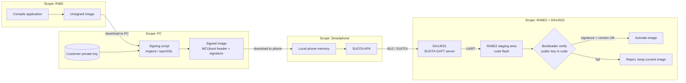

> Derived from: https://confluence.eng.renesas.com/spaces/PESKB/pages/457591511/OTA+Firmware+Updates+over+BLE+using+DA14535 — Confluence version 2 (last modified 2026-08-18), extracted 2026-09-02.
> Requirement text in the "Requirement (as written)" column is **verbatim** from the MRD. The `Security property` and `Notes` columns are analysis added here, not source text.

# Security-Related Requirements — OTA over BLE (DA14535 + RA4E2)

the purpose of this doc to review security related topics

    * section 1 notates all security requiremens in the MRD ( marked as MRK-SEC-x )

    * section 2 define systen security requirement  ( marked as SYS_SEC-x)

    * section 3 reviews the current code base and reports, per SYS-SEC requirement, what is implemented today and whether it is an acceptable solution

    note there is a mapping from marketing to system requirement , so it is sufficient to comply with system security requirement

## 1. Security requirements stated in the MRD

| ID | Component | Requirement (as written) | Security property | Notes / open points |
|----|-----------|--------------------------|-------------------|---------------------|
| MRK-SEC-01 | System | "Protects the device against invalid, corrupted, unauthorized, or interrupted updates." | Umbrella: integrity, authenticity, availability | Top-level security goal. **recomand to remove "anautorized"** requirement since it required a full blown RED certification. |
| MRK-SEC-02 | Mobile app | "Establish a secure BLE connection." | Secure channel (confidentiality + integrity in transit) | **recomend to remove** since the mobile app do not support it  |
| MRK-SEC-03 | Mobile app | "Import firmware from local storage or retrieve it from an approved server." | Source authentication / supply-chain trust | OK - the app only support local storage on the smart phone |
| MRK-SEC-04 | DA14531/35 FW | "Prevent unrestricted access to host programming commands." | Access control / privilege boundary | the mobile app doesnt support authentication ( there is a RED flavour but not recomended) **recomend to remove**  |
| MRK-SEC-05 | MCU bootloader | "Verify image integrity and authenticity before activation." | **Authentication + integrity of the firmware image** | should be supported with the following notes  (1) public key will be stored in code since RA6E2 hs no **crypto or key management HW**.  (2) packing and signing should be done outside R365 ( adding python and openSSL may be reasnable , but sharing the customer private key is not)  |
| MRK-SEC-06 | MCU bootloader | "Enforce the configured version policy." | Anti-rollback / downgrade prevention | support the "Downgrade prevention" provided by FSP bootloader |

## Firmware flow — build, signing, delivery

*Trust boundary: the private key never leaves the PC .*

*since the R365 download link was not evaluated for security risks , it is recomended that production compilation will be done localy*
